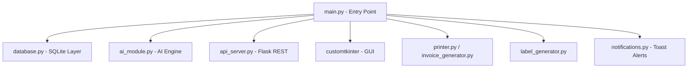

# 📦 Estoke Ao Cubo - Sistema de Gestão Inteligente

> [!ABSTRACT] Resumo do Projeto
> Sistema completo de organização e gestão empresarial para pequenos negócios e artesãos. Integra controle de estoque, financeiro, PDV, IA preditiva e multi-usuário em uma interface moderna feita com Python e CustomTkinter.

---

## 🚀 Links Rápidos
- **🌐 Website:** [estoke-ao-cubo.pages.dev](https://estoke-ao-cubo.pages.dev)
- **📄 Guia do Usuário:** `dist_package/GUIA_DO_USUARIO.txt`
- **📁 Repositório Local:** `[[g:/Meu Drive/100/EstokeAoCubo]]`

---

## 🛠️ Stack Tecnológica

| Componente | Tecnologia |
| --- | --- |
| **Linguagem** | Python 3.x |
| **Interface (GUI)** | CustomTkinter |
| **Banco de Dados** | SQLite (Módulo `database.py`) |
| **Inteligência Artificial** | Regressão Linear / Processamento de Linguagem Natural |
| **Servidor API** | Flask (Porta 5050) |
| **Relatórios/Gráficos** | Matplotlib / Pandas / Jinja2 (HTML) |
| **Scanner** | OpenCV / Pyzbar |

---

## 🗺️ Mapa de Funcionalidades

### 📊 Gestão & Dashboard
- **Dashboard em Tempo Real:** Atualização automática a cada 60 segundos.
- **Financeiro:** Saldo, Gastos, Contas a Pagar (com parcelamento) e DRE Simplificado.
- **Kits Virtuais:** Combos com baixa automática de componentes.
- **Curva ABC (Pareto):** Análise estratégica de rentabilidade de produtos.

### 💰 Ponto de Venda (PDV)
- **Multi-Formas:** Dinheiro, PIX, Cartão (Débito/Crédito) e Fiado.
- **Impressão Térmica:** Suporte direto para ESC/POS e pré-visualização de notas.
- **Scanner:** Leitura de códigos de barras via Webcam.
- **CRM:** Programa de fidelidade (1 ponto por R$10) e histórico de compras por cliente.

### 🤖 Inteligência Artificial
- **Previsão de Gastos:** Predição baseada em histórico de fluxo de caixa.
- **Chatbot Assistente:** Execução de comandos via linguagem natural.
    - `adicione um produto [nome] com [qtd] unidades...`
    - `registre um gasto de [valor] em [categoria]...`

### 🔧 Módulos Especializados
- **Restaurante:** Mapa de mesas, comandas, cozinha (Kanban) e taxas de serviço.
- **Ordem de Serviço (OS):** Workflow de 7 etapas (Recebido ➔ Concluído).
- **Etiquetas:** Gerador de etiquetas com QR Code e Código de Barras.

---

## 🏗️ Estrutura de Arquivos



---

## 📝 Banco de Dados (Tabelas Principais)
- `produtos`: Cadastro, estoque, lote/série.
- `vendas`: Registro de transações e itens.
- `usuarios`: Controle de permissões (Admin, Gerente, Vendedor, Caixa).
- `contas_pagar`: Gestão de dívidas e fornecedores.
- `clientes`: CRM e fidelidade.
- `servicos`: Ordens de serviço e status.

---

## ⚙️ Procedimentos Técnicos

### Como Executar
```bash
pip install -r requirements.txt
python main.py
```

### Criar Executável (.exe)
Execute o script `build.bat` ou via terminal:
```bash
pyinstaller --noconfirm --onefile --windowed --name "EstokeAoCubo" \
    --add-data "icon;icon" \
    --add-data "dist_package/GUIA_DO_USUARIO.txt;." \
    --collect-all customtkinter main.py
```

---

## 📈 Histórico Recente (v4.2)
- [x] Implementação de **Curva ABC**.
- [x] Novo sistema de **Ordem de Serviço**.
- [x] Rastreabilidade por **Lote/Nº de Série**.
- [x] Otimização de **Impressão Térmica**.

---

> [!TIP] Obsidian Workflow
> Você pode usar o plugin **Dataview** para criar tabelas dinâmicas de vendas ou estoque se exportar os dados do SQLite para CSV periodicamente.
